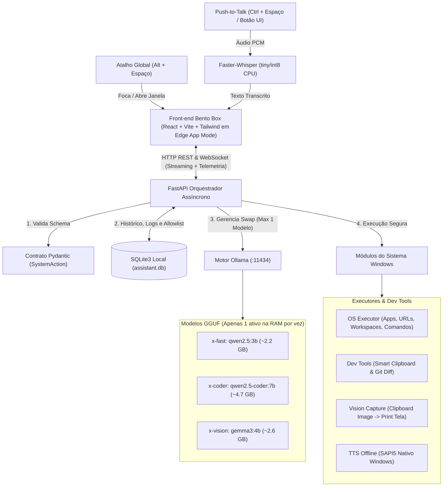

# X-Assistant — Especificação Consolidada & Plano de Implementação (v2.1)

Este documento unifica o **Documento de Arquitetura (PDF 1)** e o **Plano de Implementação Detalhado (PDF 2)**, resolvendo todas as divergências entre eles e consolidando as decisões de engenharia definidas para o hardware alvo (**Intel Core i3-1215U + 20 GB RAM Flex Mode + SSD NVMe**).

---

## 1. Decisões de Engenharia Consolidadas

| Eixo | Decisão Fechada (v2.1) | Impacto Técnico no Hardware (i3-1215U / 20 GB) |
| :--- | :--- | :--- |
| **1. Gestão de RAM (Ollama)** | **1 modelo na RAM por vez (Single-Active Model).** Ao acionar `x-coder` ou `x-vision`, o back-end descarrega o modelo anterior (`keep_alive=0`) antes de subir o novo. | Garante que o consumo de IA nunca passe de ~4.7 GB, mantendo o sistema dentro da faixa Dual-Channel e preservando memória para VS Code e navegador. |
| **2. Escopo de Workspaces** | **Workspaces Compostos:** suportam abrir Apps (`.exe`), URLs, diretórios de projeto no VS Code e comandos/scripts pré-aprovados em pastas específicas (ex: `npm run dev`). | Tudo validado por chaves na **Allowlist** (nunca executa comandos crus vindos diretamente do prompt sem validação). |
| **3. Modo Visão (`gemma3:4b`)** | **Clipboard First + Fallback Tela Inteira:** verifica primeiro se há imagem copiada no Clipboard (`Win + Shift + S`); se não houver, captura o monitor principal automaticamente. | Permite recortar apenas um erro/componente específico com `Win + Shift + S` (mais rápido para o `gemma3:4b` processar) ou analisar a tela toda sem esforço. |
| **4. Atalho Global & Voz** | **`Alt + Espaço`** abre/foca a janela do X-Assistant (estilo Spotlight/Raycast). Botão ou atalho dedicado (`Ctrl + Espaço` / botão de microfone) aciona o **Push-to-Talk** (`faster-whisper`). | Evita ativação acidental do microfone quando você só quer digitar um comando rápido. |
| **5. Retorno de Voz (TTS)** | **TTS Offline para Respostas Curtas:** além do texto/Markdown na UI, respostas de automação (`reply`) são faladas offline via SAPI5 nativo do Windows, com botão de *Mute* na UI. | Custo **zero de RAM adicional** (usa o sintetizador nativo do Windows 11 offline) e resposta imediata sem latência. |
| **6. Allowlist & Persistência** | **Híbrido (`config.py` + SQLite):** `config.py` fornece o *seed* inicial; novos Apps, Workspaces e Repositórios Git podem ser cadastrados/editados direto pela UI e ficam salvos no SQLite. | Dispensa reiniciar o servidor Python para adicionar um novo projeto ou aplicativo à lista segura. |
| **7. Interface & Empacotamento** | **Web App (React + Vite + Tailwind v4 + MUI v9 + componentes 21st.dev) + Modo App Dedicado do Edge (`--app`).** MUI cuida dos primitivos com comportamento (Dialog, inputs, Tabs, Snackbar); 21st.dev fornece as composições visuais (bento, chat, cards). Guia: skill global `mui-21st-hybrid`. Tauri fica como etapa opcional futura. | Zero dependência de compilador Rust/C++ no setup inicial e consumo mínimo de RAM (compartilha o processo do Edge WebView2 nativo do Windows). |

---

## 2. Arquitetura Consolidada e Fluxo de Dados



---

## 3. Fechamento das Lacunas Técnicas (Contratos e Módulos)

### 3.1. Contrato Pydantic Unificado (`backend/app/schemas.py`)

Unifica as divergências entre o PDF 1 (`spoken_or_text_reply` vs `reply` e lista de `intents`) e o PDF 2, além de adicionar suporte aos passos de Workspaces compostos e confirmação de segurança:

```python
from pydantic import BaseModel, Field
from typing import Literal, Optional, List

IntentType = Literal[
    "chat_response",
    "open_app",
    "run_workspace",
    "analyze_clipboard",
    "generate_git_commit",
    "analyze_screenshot",
    "free_memory",
]

ModelMode = Literal["x-fast", "x-coder", "x-vision"]

class SystemAction(BaseModel):
    intent: IntentType
    target: Optional[str] = Field(
        None,
        description="Chave exata cadastrada na Allowlist (ex: 'vscode', 'dev_web', 'x-assistant')"
    )
    requires_confirmation: bool = Field(
        False,
        description="True se a ação executar scripts de terminal ou alterar estado de repositório/sistema"
    )
    reply: str = Field(
        ...,
        description="Resposta curta e direta para exibir na UI e falar via TTS"
    )

class WorkspaceStep(BaseModel):
    type: Literal["app", "url", "vscode_project", "terminal_cmd"]
    target: str = Field(..., description="Chave do app, URL, caminho do projeto ou comando permitido")
    working_dir: Optional[str] = None

class ChatRequest(BaseModel):
    prompt: str
    mode: ModelMode = "x-fast"
    structured: bool = True
    speak_reply: bool = False
```

### 3.2. Gestão Estrita de 1 Modelo na RAM (`backend/app/services/ollama_service.py`)

Corrige o problema de chamadas síncronas (usando `ollama.AsyncClient`) e garante que, ao trocar entre `x-fast`, `x-coder` e `x-vision`, qualquer modelo anterior seja ejetado da RAM imediatamente com `keep_alive=0`:

```python
async def ensure_single_model_loaded(target_model: ModelMode) -> str:
    """Descarrega qualquer outro modelo ativo no Ollama antes de carregar o target_model."""
    resolved_target = await resolve_available_model(target_model)
    active_models = await get_active_ollama_models()
    for active in active_models:
        if active != resolved_target and active.split(":")[0] != resolved_target.split(":")[0]:
            await async_client.generate(model=active, prompt="", keep_alive=0)
    return resolved_target
```

### 3.3. Captura Inteligente de Visão (`Clipboard -> Tela Inteira`)

Fecha a lacuna do módulo de análise visual que faltava no PDF 2:

```python
def capture_visual_context(source_preference: str = "auto") -> tuple[Path, str]:
    """
    1. Tenta ler imagem da área de transferência (Win + Shift + S).
    2. Se não houver imagem no Clipboard, captura a tela inteira automaticamente.
    """
    if source_preference in ("auto", "clipboard"):
        clip_data = ImageGrab.grabclipboard()
        if isinstance(clip_data, Image.Image):
            clip_data.save(latest_path, "PNG")
            return latest_path, "clipboard"

    screen_img = ImageGrab.grab(all_screens=False)
    screen_img.save(latest_path, "PNG")
    return latest_path, "fullscreen"
```

### 3.4. Banco de Dados SQLite & Allowlist Híbrida (`backend/app/database.py`)

O banco SQLite (`assistant.db`) possui 6 tabelas leves:
1. **`allowed_apps`**: `key` (PK), `name`, `executable_path`, `args`, `requires_confirmation`
2. **`workspaces`**: `key` (PK), `name`, `description`, `requires_confirmation`, `steps_json` (suporta apps, URLs, pastas no VS Code e comandos de terminal em diretórios específicos)
3. **`git_repos`**: `key` (PK), `name`, `repo_path`
4. **`audit_logs`**: `id`, `timestamp`, `action_type`, `target_key`, `status`, `details`
5. **`chat_history`**: `id`, `timestamp`, `role`, `model_used`, `content`, `intent`
6. **`pending_confirmations`**: `id`, `timestamp`, `intent`, `target`, `reply`, `status`

---

## 4. Estrutura de Diretórios do Monorepo

```text
xouel-assistant/
├── ESPECIFICACAO_CONSOLIDADA_X_ASSISTANT.md
├── backend/
│   ├── app/
│   │   ├── main.py                 # FastAPI, Rotas REST, WebSockets (Chat + Telemetria)
│   │   ├── config.py               # Seeds iniciais da Allowlist, Workspaces e Configurações
│   │   ├── database.py             # SQLite3 (Histórico, Logs de Auditoria e Allowlist editável)
│   │   ├── schemas.py              # Contratos Pydantic (SystemAction, WorkspaceStep, etc.)
│   │   └── services/
│   │       ├── ollama_service.py   # AsyncClient, Structured Outputs e Swap de 1 Modelo na RAM
│   │       ├── os_executor.py      # Execução segura de Apps, URLs, Pastas VS Code e Comandos
│   │       ├── dev_tools.py        # Smart Clipboard, Git Diff -> Commit e Captura de Visão
│   │       ├── telemetry.py        # Monitoramento psutil (RAM Total, RAM Ollama, CPU, Modelo Ativo)
│   │       └── voice_service.py    # Faster-Whisper (STT int8) + TTS SAPI5 Offline
│   ├── Modelfiles/
│   │   ├── Modelfile.fast          # qwen2.5:3b-instruct (num_thread 4, num_ctx 4096)
│   │   ├── Modelfile.coder         # qwen2.5-coder:7b-instruct (num_thread 6, num_ctx 8192)
│   │   └── Modelfile.vision        # gemma3:4b (num_thread 4, num_ctx 4096)
│   └── requirements.txt
├── frontend/
│   ├── src/
│   │   ├── components/
│   │   │   ├── BentoGrid.tsx       # Layout principal Bento Box Dark
│   │   │   ├── ChatPanel.tsx       # Chat com Streaming Markdown, Push-to-Talk e confirmação
│   │   │   ├── TelemetryCard.tsx   # Barra de RAM/CPU em tempo real + botão "Ejetar RAM"
│   │   │   ├── QuickActions.tsx    # Botões rápidos (Workspaces, Clipboard, Git Commit, Print)
│   │   │   └── AllowlistModal.tsx  # Gerenciador visual de Apps e Workspaces (SQLite)
│   │   ├── hooks/
│   │   │   └── useAssistant.ts     # Estado do WebSocket, telemetria e atalhos
│   │   └── App.tsx
│   ├── package.json
│   └── vite.config.ts
└── scripts/
    ├── setup_models.bat            # Faz pull e compila x-fast, x-coder e x-vision no Ollama
    └── start_x_assistant.pyw       # Inicia Back-end, registra Alt+Espaço global e abre Edge em modo --app
```

---

## 5. Sequência de Execução (Fases 1 a 5)

1. **Fase 1 — Setup de Modelos e Tuning (Ollama):** Executar `scripts\setup_models.bat` para baixar `qwen2.5:3b-instruct`, `qwen2.5-coder:7b-instruct` e `gemma3:4b`, compilar os aliases `x-fast`, `x-coder` e `x-vision`, e fixar `OLLAMA_MAX_LOADED_MODELS=1`.
2. **Fase 2 — Back-end Core (FastAPI + SQLite + Telemetria):** Inicializar `assistant.db` com seed automático, endpoints de telemetria (`psutil`) e rota `/system/unload` (`keep_alive=0`).
3. **Fase 3 — Automação Windows, Dev Tools, Visão e Voz:** Conectar o orquestrador de intenções ao executor de Apps/Workspaces, análise de Clipboard, gerador de commits Git, captura visual (`Clipboard -> Tela`) e camada de voz (`faster-whisper` + TTS SAPI5).
4. **Fase 4 — Front-end Bento Box (React + Vite + Tailwind):** Interface escura responsiva com monitor de RAM em tempo real, seletor de modelos, ações rápidas e gerenciador de Allowlist/Workspaces.
5. **Fase 5 — Atalho Global (`Alt + Espaço`) e Modo App Edge:** Script de inicialização unificado que abre a UI como aplicativo nativo via Edge (`--app`) e foca a janela com `Alt + Espaço`.

