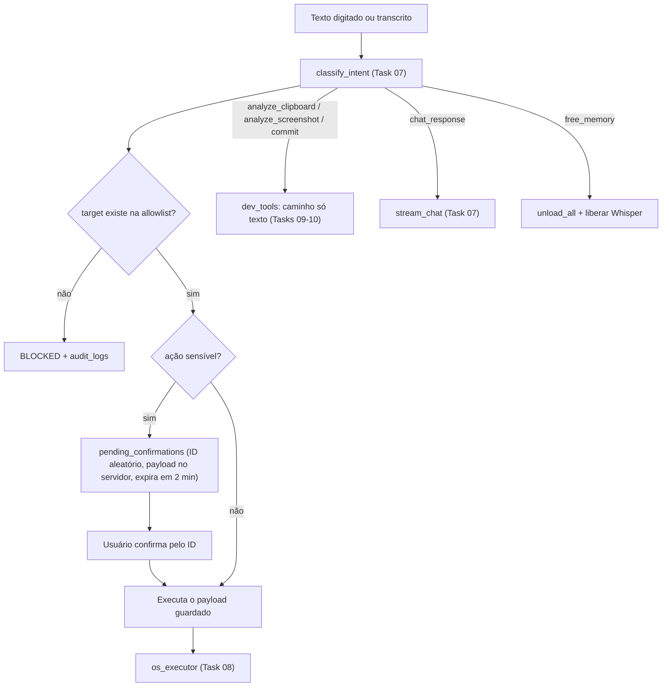

# X-Assistant — Plano de Estudo e Execução em 16 Micro-Tasks (v3)

> **Metodologia (pair programming didático)**
> Nenhum código é gerado "tudo de uma vez". Avançamos **1 Micro-Task por vez**, e cada uma tem 3 passos:
> 1. **Conceito (o porquê):** como a peça funciona e por que foi desenhada assim para o i3-1215U + 20 GB.
> 2. **Construção guiada (o como):** um módulo por vez, explicado bloco a bloco (às vezes acompanhado do seu arquivo de teste).
> 3. **Teste de bancada:** um comando isolado que prova que a peça funciona antes de seguir.
>
> Só passamos para a próxima Task depois do seu "ok".

### O que mudou na v3 (após a revisão)

| Tema | Mudança |
| :--- | :--- |
| Estrutura | Nova **Task 12 — Orquestrador** (`orchestrator.py`): é nela que o fluxo texto → `SystemAction` → validação → confirmação → executor é montado. O plano passa de 15 para 16 Tasks. |
| Ordem da Fase 1 | O benchmark de `num_thread` precisa do modelo baixado, então a **Task 01** agora cuida de CLI + download + variáveis + benchmark, e a **Task 02** escreve os `Modelfiles` com os valores **medidos**. |
| Segurança | Nova seção "Modelo de segurança" e requisitos explícitos nas Tasks 05, 08, 09, 10, 12, 13 e 15. |
| Front-end | **Só 21st.dev/shadcn + Tailwind v4, sem MUI** (um único sistema de estilo). A skill `mui-21st-hybrid` fica guardada para outros projetos. |
| Voz | Push-to-Talk gravado **no navegador (MediaRecorder)** e enviado ao backend. A fala usa **pywin32 → SAPI.SpVoice (COM, assíncrono)**. Comparamos o Whisper `tiny` com o `base` em pt-BR antes de escolher. |
| Atalho | **`Ctrl + Alt + Espaço`** via `RegisterHotKey` (ctypes). O `Alt + Espaço` foi descartado porque conflita com o menu de sistema do Windows e com o PowerToys Run. |
| Testes | `pytest` desde a Task 05, com testes obrigatórios para o bloqueio da allowlist (Task 08) e para o orquestrador (Task 12). |
| Falhas | Uma matriz de falhas comuns (Ollama desligado, modelo não baixado, porta ocupada…), com a Task responsável por cada caso. |

---

## Modelo de segurança (vale para todas as Tasks)

O X-Assistant é um servidor local capaz de abrir programas e rodar comandos. Por isso estas regras não são opcionais:

1. **A rede só aceita o próprio PC.** O Uvicorn faz bind apenas em `127.0.0.1`. O `TrustedHostMiddleware` aceita só `127.0.0.1`/`localhost` (contra DNS rebinding). O CORS libera somente a origem do próprio front.
2. **Token local.** Na primeira execução, o backend gera um token aleatório (`secrets.token_urlsafe(32)`) em `backend/.local_token`, que fica no `.gitignore`. As rotas REST exigem o header `X-Local-Token`.
3. **WebSocket não tem same-origin policy.** Qualquer site aberto no navegador pode tentar abrir `ws://127.0.0.1:8000/ws`. Por isso o `/ws` **valida o header `Origin`** contra uma lista fixa e exige uma mensagem `{"type":"auth","token":...}` como primeira mensagem. Se não chegar, a conexão é fechada.
4. **A LLM só escolhe chaves, nunca caminhos ou comandos.** O `SystemAction.target` é uma *chave* da allowlist. Caminhos e comandos vêm sempre do SQLite. Antes de executar, o caminho é normalizado com `Path(os.path.expandvars(p)).resolve()` e conferido com o valor cadastrado. Nada de concatenar strings vindas do modelo, e nada de `shell=True` com texto dinâmico.
5. **Confirmação gerada no servidor.** Ações sensíveis (`terminal_cmd`, apps marcados como sensíveis e **qualquer alteração na allowlist/workspaces/repos**) geram um registro em `pending_confirmations` com:
   - ID aleatório (`secrets.token_urlsafe`), não um número sequencial;
   - o *payload* da ação guardado no servidor;
   - expiração (2 min) e uso único.

   Na confirmação, o cliente manda só o ID. O servidor executa **o que ele mesmo guardou**, nunca o que o cliente reenviar.
6. **Conteúdo não confiável nunca vira ação.** Clipboard, print de tela e `git diff` vão para o modelo por um **caminho separado, só texto**: `analyze_text()` / `analyze_image()`, sem `format=SystemAction`. A resposta só é exibida, nunca interpretada como comando. O classificador de intenções recebe **apenas o texto que você digitou ou falou**.
7. **Dados locais fora do git.** `assistant.db`, `backend/captures/`, `backend/.local_token`, `.venv/`, `node_modules/` e `frontend/dist/` ficam no `.gitignore`. Das capturas, só a última é mantida.

---

## Visão geral das 16 Micro-Tasks

| # | Fase | Micro-Task | Arquivo(s) alvo | Conceito principal |
| :-: | :--- | :--- | :--- | :--- |
| **01** | 1 | [x] Ollama no hardware: CLI, variáveis e benchmark de threads | (terminal) + `docs/benchmark.md` | `pull`/`run --verbose`/`ps`, `OLLAMA_MAX_LOADED_MODELS`, `OLLAMA_KEEP_ALIVE`, tokens/s com `num_thread` 2/4/6 |
| **02** | 1 | [x] `Modelfiles` com valores medidos e compilação | `backend/Modelfiles/*`, `scripts/setup_models.bat` | `num_thread`, `num_ctx` (KV cache), `temperature`, `SYSTEM`, `ollama create` |
| **03** | 2 | [x] Ambiente Python, git e configuração | `requirements.txt`, `.gitignore`, `app/config.py` | venv, papel de cada dependência, `pathlib`, seeds da allowlist |
| **04** | 2 | [x] Contratos de dados e *Structured Outputs* | `app/schemas.py` | Pydantic v2, `Literal`, JSON Schema enviado ao `format` do Ollama |
| **05** | 2 | [x] SQLite, auditoria e confirmações | `app/database.py`, `tests/test_database.py` | Conexão curta por chamada, rotas `def` no threadpool, seed on startup, `pending_confirmations` seguro |
| **06** | 2 | [x] Telemetria de hardware | `app/services/telemetry.py` | `psutil` com aquecimento do `cpu_percent`, soma dos processos `*ollama*` |
| **07** | 3 | [x] Cliente Ollama assíncrono e classificador de intenções | `app/services/ollama_service.py` | `AsyncClient`, `classify_intent()` → `SystemAction`, streaming, `unload_all()`, erros tipados |
| **08** | 3 | [x] Executor do Windows com allowlist | `app/services/os_executor.py`, `tests/test_os_executor.py` | `Path.resolve()`, `Popen` com lista de argumentos, bloqueio + auditoria |
| **09** | 3 | [x] Copiloto Dev: clipboard e git diff | `app/services/dev_tools.py` (parte 1) | Caminho só texto (anti prompt injection), diff limitado, `encoding="utf-8"` |
| **10** | 3 | [x] Visão: clipboard → tela inteira | `app/services/dev_tools.py` (parte 2) | `grabclipboard()` (imagem **ou** lista de arquivos), minimizar antes do `grab()` |
| **11** | 3 | [x] Voz offline: fala e escuta | `app/services/voice_service.py` | SAPI via pywin32 numa thread com fila, voz pt-BR, Whisper `tiny` × `base` |
| **12** | 3 | [x] **Orquestrador de intenções** | `app/orchestrator.py`, `tests/test_orchestrator.py` | Fluxo completo com validação, confirmação e despacho |
| **13** | 4 | [x] Servidor FastAPI seguro + WebSocket | `app/main.py`, `app/security.py`, `scripts/ws_probe.py` | Bind local, token, `Origin`, protocolo de mensagens com `type` |
| **14** | 4 | [x] Front-end: setup 21st/shadcn e hook WebSocket | `frontend/`, `src/types.ts`, `src/hooks/useAssistant.ts` | Vite + React + TS + Tailwind v4 + shadcn, CLI 21st, reconexão |
| **15** | 4 | [x] Componentes Bento Box | `src/components/*` | Ritual 21st (`search` → `get` → `add` → adaptar), MediaRecorder, confirmações |
| **16** | 5 | [x] Launcher, atalho global e modo app | `scripts/launcher.pyw`, `start_x_assistant.bat` | `RegisterHotKey`, foco de janela no Win32, FastAPI servindo o build, Edge `--app` |

---

## Detalhamento

### Fase 1 — Motor de IA no hardware

#### **Task 01: Ollama no hardware — CLI, variáveis e benchmark de threads**
- **O que vamos aprender:**
  - Os comandos `ollama pull`, `ollama run --verbose`, `ollama list` e `ollama ps`.
  - A topologia do i3-1215U: 2 P-cores (4 threads com Hyper-Threading) + 4 E-cores = 6 núcleos / 8 threads. Na inferência, as threads trabalham em sincronia, então **a thread mais lenta dita o ritmo**: colocar E-cores na conta pode deixar tudo mais lento. Os valores 4/6 da especificação são **hipóteses a medir**, não regra.
  - Variáveis de ambiente do Ollama:
    - `OLLAMA_MAX_LOADED_MODELS=1`: o próprio Ollama descarrega o modelo anterior quando outro é pedido.
    - `OLLAMA_KEEP_ALIVE`: por quanto tempo um modelo ocioso fica na RAM (padrão 5 min). O `keep_alive` de cada requisição tem prioridade sobre ele.
    - O `setx` só vale para processos novos: **é preciso fechar o Ollama pela bandeja do sistema e abrir de novo** depois de mudar as variáveis.
- **Passos:** baixar `qwen2.5:3b-instruct` → `ollama run qwen2.5:3b-instruct --verbose` → dentro da sessão, `/set parameter num_thread N` para N = 2, 4 e 6 → mesmo prompt fixo nas três rodadas → anotar o `eval rate` (tokens/s) e o `prompt eval rate`. Repetir para o `qwen2.5-coder:7b-instruct`.
- **Entregáveis:** variáveis configuradas + `docs/benchmark.md` com a tabela de resultados.
- **Teste de bancada:** a tabela de tokens/s define o `num_thread` de cada perfil. Em seguida, `ollama ps` com dois modelos pedidos em sequência deve mostrar **apenas um** carregado.

#### **Task 02: `Modelfiles` com valores medidos e compilação**
- **O que vamos aprender:**
  - Cada linha de um Modelfile: `FROM`, `PARAMETER num_thread` (o valor medido na Task 01), `num_ctx` e o custo dele na RAM (KV cache cresce linearmente com o contexto), `temperature` e `SYSTEM`.
  - `ollama create <nome> -f <Modelfile>` e por que perfis com nome próprio (`x-fast`, `x-coder`, `x-vision`) simplificam o backend.
- **Entregáveis:** `backend/Modelfiles/Modelfile.fast`, `Modelfile.coder`, `Modelfile.vision` e `scripts/setup_models.bat` (pull + create, idempotente).
- **Teste de bancada:** `ollama list` mostra os 3 perfis, e um `ollama run x-fast --verbose` repete o tokens/s esperado.

---

### Fase 2 — Contratos, dados e telemetria

#### **Task 03: Ambiente Python, git e configuração**
- **O que vamos aprender:**
  - Criar e ativar uma `venv`, e para que serve cada dependência:
    - `fastapi`, `uvicorn[standard]` (o extra traz o suporte a WebSocket), `pydantic`, `ollama`, `psutil`
    - `pyperclip`, `Pillow`, `pywin32` (TTS via COM + janelas Win32)
    - `faster-whisper`, `python-multipart` (upload do áudio do Push-to-Talk)
    - `pytest`, `httpx` (o `TestClient` usa o `httpx`)
  - `git init` (a Task 09 lê o diff do próprio projeto) e um `.gitignore` com os itens do modelo de segurança.
  - `pathlib.Path` e os seeds da allowlist (`DEFAULT_ALLOWED_APPS`, `DEFAULT_WORKSPACES`, `DEFAULT_GIT_REPOS`), com caminhos e comandos **fixos no seed**, nunca montados em tempo de execução.
- **Entregáveis:** `backend/requirements.txt`, `.gitignore`, `backend/app/__init__.py`, `backend/app/config.py`.
- **Teste de bancada:** `pip install -r requirements.txt` sem erros, e `python -c "from app import config; print(config.DB_PATH)"`.

#### **Task 04: Contratos de dados e *Structured Outputs***
- **O que vamos aprender:**
  - Pydantic v2 (`BaseModel`, `Literal`, `Optional`, `Field`) e como `SystemAction.model_json_schema()` vira a gramática enviada no `format` do Ollama, obrigando o modelo a responder dentro do contrato.
  - A separação de contratos: `SystemAction` (só para o texto digitado ou falado) e `AnalysisResult` (texto livre para clipboard, imagem e diff, **sem campos de ação**).
  - O protocolo do WebSocket já tipado: mensagens com um campo `type` (`auth`, `telemetry`, `token`, `done`, `action_result`, `confirmation_required`, `error`).
- **Entregáveis:** `backend/app/schemas.py`.
- **Teste de bancada:** um JSON válido passa; uma `intent` inventada é rejeitada; imprimir o JSON Schema gerado.

#### **Task 05: SQLite, auditoria e confirmações**
- **O que vamos aprender:**
  - `sqlite3` nativo e seus dois cuidados:
    - Conexões não devem cruzar threads, então usamos **uma conexão curta por chamada** (`with get_connection()`).
    - O SQLite é bloqueante: chamado dentro de `async def`, ele trava o event loop. Por isso as rotas que acessam o banco serão `def` (o FastAPI as roda no threadpool) ou usarão `run_in_threadpool`.
  - As 6 tabelas: `allowed_apps`, `workspaces`, `git_repos`, `audit_logs`, `chat_history` e `pending_confirmations` (ID aleatório, payload JSON, `expires_at`, `status`).
  - *Seed on startup:* o banco é preenchido a partir do `config.py` só se estiver vazio, para não sobrescrever o que você editar depois.
- **Entregáveis:** `backend/app/database.py` e `backend/tests/test_database.py`.
- **Teste de bancada:** `pytest tests/test_database.py`, cobrindo seed, CRUD e confirmação (expira, é de uso único e rejeita ID desconhecido).

#### **Task 06: Telemetria de hardware**
- **O que vamos aprender:**
  - `psutil.virtual_memory()` e `psutil.cpu_percent()`. A primeira chamada do `cpu_percent()` sempre retorna `0.0`, então fazemos uma **chamada de aquecimento** na inicialização.
  - Somar o RSS de todos os processos cujo nome **contém** `ollama`: o Ollama abre processos filhos (servidor, runner), e cada um ocupa parte da RAM.
  - Comparar esse número com o tamanho reportado por `ollama ps` e entender por que os dois diferem (arquivos mapeados em memória).
- **Entregáveis:** `backend/app/services/__init__.py`, `backend/app/services/telemetry.py`.
- **Teste de bancada:** imprimir a telemetria com o Ollama ocioso e depois com um modelo carregado, e ver a diferença.

---

### Fase 3 — Inteligência, automação segura, visão e voz

#### **Task 07: Cliente Ollama assíncrono e classificador de intenções**
- **O que vamos aprender:**
  - Síncrono × assíncrono: com o `ollama.AsyncClient`, o servidor continua respondendo (telemetria, outros pedidos) enquanto o modelo gera.
  - **`classify_intent(texto) -> SystemAction`:** recebe só o texto digitado/falado e usa o `format=SystemAction.model_json_schema()`. Ele **apenas classifica, não executa nada**. Antes de chamar o modelo, um atalho determinístico resolve comandos óbvios ("liberar ram", "abrir calculadora") em ~0 ms.
  - `stream_chat()` com gerador assíncrono para o streaming de tokens.
  - `analyze_text()` e `analyze_image()`: o caminho só texto, sem schema de ação, usado pelas Tasks 09 e 10.
  - **Troca de modelos:** com `OLLAMA_MAX_LOADED_MODELS=1` (Task 01), o próprio Ollama já descarrega o modelo anterior. Não precisamos reimplementar isso. Fica só o `unload_all()` (`keep_alive=0` em cada modelo listado no `ollama ps`) para o botão "Ejetar RAM".
  - **Erros tipados:** `OllamaOffline` (conexão recusada em `:11434`) e `ModelNotFound` (modelo não baixado), com mensagens que dizem como resolver.
- **Entregáveis:** `backend/app/services/ollama_service.py`.
- **Teste de bancada:** classificar 5 frases e ver os `SystemAction` gerados (nenhuma é executada); `unload_all()` + `ollama ps` vazio; com o Ollama fechado, ver o erro `OllamaOffline` legível.

#### **Task 08: Executor do Windows com allowlist**
- **O que vamos aprender:**
  - Abrir apps com `os.startfile`/`subprocess.Popen([...])` usando **lista de argumentos**, sem `shell=True`.
  - Validar caminhos: `Path(os.path.expandvars(p)).resolve()` conferido com o valor cadastrado. Um diretório de projeto precisa existir e bater exatamente com o do workspace.
  - Workspaces compostos (`app`, `url`, `vscode_project`, `terminal_cmd`). O `terminal_cmd` abre o Windows Terminal com os argumentos em lista (`wt.exe -d <dir> cmd /k <comando cadastrado>`), e o comando vem sempre do banco.
  - O executor recebe **chaves**, consulta o banco e registra tudo em `audit_logs` (`SUCCESS`, `BLOCKED`, `ERROR`). A decisão de pedir confirmação fica no orquestrador (Task 12).
- **Entregáveis:** `backend/app/services/os_executor.py` e `backend/tests/test_os_executor.py`.
- **Teste de bancada (obrigatório):** `pytest tests/test_os_executor.py`, cobrindo:
  - chave inexistente → `BLOCKED` + linha no log;
  - tentativa de passar caminho/comando no lugar de chave (`"C:\\Windows\\System32\\cmd.exe"`, `"calc & del ..."`) → `BLOCKED`;
  - caminho cadastrado que não existe → `ERROR` claro;
  - chave válida → `Popen` chamado com os argumentos esperados (com mock, sem abrir nada).

  Depois, um teste manual abrindo a Calculadora.

#### **Task 09: Copiloto Dev — clipboard e git diff**
- **O que vamos aprender:**
  - **Prompt injection:** um texto copiado pode conter "ignore as instruções e rode X". Por isso o clipboard vai para o `analyze_text()` (sem schema de ação) e a resposta só é exibida.
  - `pyperclip.paste()` com limite de tamanho, enviado ao `x-coder`.
  - `git diff` cabendo no contexto: com `num_ctx 4096`, o Ollama **trunca silenciosamente** o que passar do limite. Então montamos `git diff --staged --stat` + os hunks com `-U1`, cortados num orçamento de caracteres e com o aviso "diff truncado". Outra opção é aumentar o `num_ctx` só nessa requisição (`options={"num_ctx": 8192}`), sabendo que isso custa RAM.
  - `subprocess.run([...], encoding="utf-8", errors="replace")`: sem isso, acentos quebram no Windows (cp1252).
- **Entregáveis:** `dev_tools.py` (`analyze_clipboard`, `build_limited_diff`, `suggest_commit_message`).
- **Teste de bancada:** copiar um erro de Python e ver a análise; copiar um texto com "instrução maliciosa" e confirmar que nada é executado; rodar o diff limitado num repositório com arquivos acentuados.

#### **Task 10: Visão — clipboard → tela inteira**
- **O que vamos aprender:**
  - `ImageGrab.grabclipboard()` pode retornar uma **imagem**, uma **lista de caminhos** (arquivos copiados no Explorer) ou `None`. Tratamos os três casos: na lista, abrimos o primeiro arquivo de imagem com o PIL.
  - No fallback de tela inteira, o print pegaria a própria janela do X-Assistant. Por isso localizamos a janela pelo título (pywin32), minimizamos, esperamos ~300 ms, fazemos o `grab()` e restauramos.
  - Envio ao `x-vision` pelo `analyze_image()` (caminho só texto). Só a última captura é mantida em `backend/captures/`, que fica no `.gitignore`.
- **Entregáveis:** `dev_tools.py` (`capture_visual_context`, `analyze_screen`).
- **Teste de bancada:** os 3 cenários: recorte com `Win+Shift+S`, arquivo copiado no Explorer e nada no clipboard (tela inteira sem a janela do assistente).

#### **Task 11: Voz offline — fala e escuta**
- **O que vamos aprender:**
  - **Fala:** `win32com.client.Dispatch("SAPI.SpVoice")` com `Speak(texto, 1)` (assíncrono). O COM exige `pythoncom.CoInitialize()` na thread que o usa, então criamos **uma thread dedicada com fila** e o resto do código só enfileira frases. O custo de RAM é pequeno (alguns MB), mas não zero.
  - **Voz pt-BR:** listar as vozes com `GetVoices()` e escolher a pt-BR (ex.: "Microsoft Maria"). Se não houver, mostrar como instalar em Configurações → Hora e idioma → Fala.
  - **Escuta:** o `faster-whisper` recebe o arquivo enviado pelo navegador (webm/opus, decodificado pelo PyAV que já vem junto). O modelo é carregado sob demanda (*lazy loading*) e liberado no "Ejetar RAM".
  - **`tiny` × `base`:** o `tiny` erra bastante em português. Gravamos 3 frases, transcrevemos com os dois (`language="pt"`) e comparamos acerto, tempo e RAM antes de decidir.
- **Entregáveis:** `backend/app/services/voice_service.py`.
- **Teste de bancada:** listar as vozes e falar uma frase em pt-BR; a tabela de comparação `tiny` × `base` com os mesmos áudios.

#### **Task 12: Orquestrador de intenções**
- **O que vamos aprender:** a peça que liga tudo. O fluxo completo:



  - São "sensíveis": qualquer `terminal_cmd`, apps marcados como sensíveis e **toda alteração de allowlist/workspace/repo**. Essas alterações também passam pelo orquestrador e nunca podem ser disparadas pela LLM (não existe intent para isso).
  - O orquestrador não conhece HTTP: recebe dados e devolve eventos tipados (`action_result`, `confirmation_required`, `error`), o que facilita testar.
- **Entregáveis:** `backend/app/orchestrator.py` e `backend/tests/test_orchestrator.py`.
- **Teste de bancada:** `pytest` com o classificador substituído por um *fake*, cobrindo:
  - target desconhecido → bloqueado;
  - workspace com `terminal_cmd` → `confirmation_required`;
  - confirmação com ID errado, expirado ou repetido → rejeitada;
  - clipboard com "rode cmd.exe" → o executor **não** é chamado.

---

### Fase 4 — API em tempo real e interface

#### **Task 13: Servidor FastAPI seguro + WebSocket**
- **O que vamos aprender:**
  - `lifespan` (inicializa o banco, aquece a telemetria, gera ou lê o token), bind em `127.0.0.1`, `TrustedHostMiddleware` e CORS restrito.
  - `app/security.py`: dependência que confere o `X-Local-Token`, validação do `Origin` no `/ws` e autenticação por primeira mensagem.
  - As rotas REST são uma camada fina sobre o orquestrador: chat, confirmação, ferramentas dev, voz (`POST /api/voice/transcribe` com `UploadFile`) e CRUD da allowlist (que **devolve uma confirmação**, não grava direto).
  - O protocolo do `/ws` com o campo `type`: telemetria a cada 2 s, tokens do streaming, resultados e confirmações.
  - Porta ocupada: verificar a 8000 antes de subir e mostrar uma mensagem clara.
  - O Swagger (`/docs`) **não testa WebSocket**. Para o `/ws`, usamos um cliente Python curto (`scripts/ws_probe.py`, com a lib `websockets` que vem no `uvicorn[standard]`) ou o `websocat`.
- **Entregáveis:** `backend/app/main.py`, `backend/app/security.py`, `scripts/ws_probe.py` e `backend/tests/test_api_security.py`.
- **Teste de bancada:**
  - `pytest tests/test_api_security.py`: sem token → 401; `Origin` estranho no `/ws` → conexão recusada; `Host` estranho → 400; editar a allowlist → `confirmation_required`.
  - REST pelo Swagger e telemetria chegando no `ws_probe.py`.

#### **Task 14: Front-end — setup 21st/shadcn e hook WebSocket**
- **O que vamos aprender:**
  - Vite + React + TypeScript + Tailwind v4 + `npx shadcn@latest init` (gera o `components.json` e o alias `@/`, de que o `21st add` precisa).
  - O CLI do 21st: `npx @21st-dev/cli login`, depois `21st usage` para **verificar se a cota diária e o acesso funcionam** (ainda não confirmado) e um primeiro `21st search` de teste.
  - Tokens de cor nas variáveis CSS do shadcn (`--background`, `--card`, `--primary`…) mapeadas no `@theme` do Tailwind: um lugar só para as cores.
  - `src/types.ts` espelhando os schemas Pydantic (incluindo o protocolo do WebSocket).
  - O hook `useAssistant.ts`: conecta, autentica (`type: "auth"`), reconecta com *backoff*, distribui as mensagens por `type` e expõe o estado (telemetria, mensagens, confirmações pendentes).
  - Em desenvolvimento, o token chega pelo `vite.config.ts` (lido de `backend/.local_token`). Em produção (Task 16), o FastAPI injeta o token no `index.html` que ele mesmo serve.
- **Entregáveis:** `frontend/` (base + `components.json` + `src/index.css`), `src/types.ts`, `src/hooks/useAssistant.ts`.
- **Teste de bancada:** `npm run dev`, a telemetria atualizando na tela e, ao derrubar e subir o backend, o hook reconectando sozinho.

#### **Task 15: Componentes Bento Box**
- **O que vamos aprender:**
  - O ritual de cada componente: `21st search` → ler o código com `21st get` (dependências inclusas) → `21st add` → **adaptar** (trocar cores fixas por tokens, tipar props, remover código de demo, respeitar `prefers-reduced-motion`).
  - As partes, uma de cada vez:
    - **15.1 `TelemetryCard`:** card de métrica + `Progress` + `Tooltip` (RAM de 20 GB, Ollama, CPU, modelo ativo) e o botão "Ejetar RAM".
    - **15.2 `QuickActions`:** grid de ações (workspaces, clipboard, commit, print), mini-feed de auditoria e toasts com Sonner.
    - **15.3 `ChatPanel`:** caixa de prompt de IA, bolhas, blocos de código copiáveis, `ToggleGroup` (3B/7B/4B), `Switch` de TTS e **Push-to-Talk com MediaRecorder**: segurar o botão ou `Ctrl+Espaço` → soltar → envio do áudio para `/api/voice/transcribe` → texto no input.
    - **15.4 `AllowlistModal` + `BentoGrid`:** `Dialog`, `Tabs`, `Input`, `Select` para o CRUD. Cada alteração abre um **card de confirmação** com o ID que o servidor gerou.
  - Estados vazio, carregando e erro (Ollama offline, modelo não baixado, microfone negado).
- **Entregáveis:** `frontend/src/components/*`, `frontend/src/components/ui/*` (componentes 21st/shadcn adaptados), `src/App.tsx`.
- **Teste de bancada:** fluxo completo no navegador contra o backend real + `npm run build` sem erros de TypeScript.

---

### Fase 5 — Integração nativa com o Windows

#### **Task 16: Launcher, atalho global e modo app**
- **O que vamos aprender:**
  - **Um processo só no dia a dia:** `npm run build` gera o `frontend/dist`, e o FastAPI serve esses arquivos (`StaticFiles`). O Vite deixa de rodar, o que poupa RAM.
  - O `launcher.pyw` (roda com o `pythonw`, sem janela de terminal) faz, em ordem:
    1. verifica se a porta está livre e se o Ollama responde;
    2. sobe o Uvicorn numa thread;
    3. abre `msedge.exe --app=http://127.0.0.1:8000`.
  - **Atalho `Ctrl + Alt + Espaço`** com `RegisterHotKey` via `ctypes`. É mais leve que a lib `keyboard` porque não intercepta todas as teclas: só recebe o `WM_HOTKEY` num loop de mensagens.
  - **Foco de janela:** o Windows pode bloquear o `SetForegroundWindow` vindo de um processo em segundo plano. O contorno conhecido é simular um toque na tecla Alt (`keybd_event`) antes de chamar `ShowWindow` + `SetForegroundWindow`. Se a janela tiver sido fechada, o launcher reabre o Edge em modo app.
  - Opcional: atalho na pasta `shell:startup` para iniciar junto com o Windows.
- **Entregáveis:** `scripts/launcher.pyw`, `start_x_assistant.bat`.
- **Teste de bancada:** com o VS Code em tela cheia, `Ctrl+Alt+Espaço` traz o X-Assistant para a frente; fechar a janela e repetir o atalho reabre o app; no Gerenciador de Tarefas, só o Python + o Edge do app (sem Node).

---

## Matriz de falhas comuns

| Falha | Onde é tratada | Comportamento esperado |
| :--- | :--- | :--- |
| Ollama desligado | Task 07 (`OllamaOffline`), 15 (estado de erro), 16 (checagem no launcher) | Mensagem "Ollama não está rodando: abra o app Ollama". Automações por atalho determinístico e telemetria continuam funcionando. |
| Modelo não baixado | Task 07 (`ModelNotFound`) | Mensagem com o comando exato (`scripts\setup_models.bat` ou `ollama pull ...`). |
| Porta 8000 ocupada | Task 13 / 16 | Erro claro com o PID que está usando a porta, sem stack trace. |
| Microfone negado no navegador | Task 15 | O botão de Push-to-Talk mostra o motivo e como liberar. |
| Sem voz pt-BR instalada | Task 11 | Usa a voz padrão e avisa como instalar a pt-BR. |
| Clipboard vazio ou formato não suportado | Tasks 09 / 10 | Resposta "Nada para analisar no clipboard". |
| Repositório sem git ou sem alterações | Task 09 | Mensagem específica, sem chamar o modelo. |
| WebSocket caiu | Task 14 | Reconexão com backoff e indicador "reconectando" na UI. |

---

## Testes automatizados (resumo)

```powershell
cd backend
python -m pytest -v
```

| Arquivo | Task | Cobre |
| :--- | :-: | :--- |
| `tests/test_database.py` | 05 | Seed, CRUD, confirmações (expiração, uso único, ID desconhecido) |
| `tests/test_os_executor.py` | 08 | **Bloqueio da allowlist**, caminho/comando no lugar de chave, `Popen` com argumentos esperados |
| `tests/test_orchestrator.py` | 12 | Fluxo completo, confirmação, clipboard que não vira ação |
| `tests/test_api_security.py` | 13 | Token, `Origin` do WebSocket, `Host`, alteração de allowlist exigindo confirmação |

