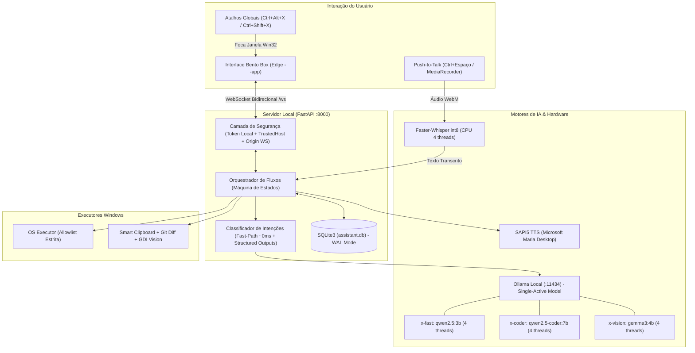
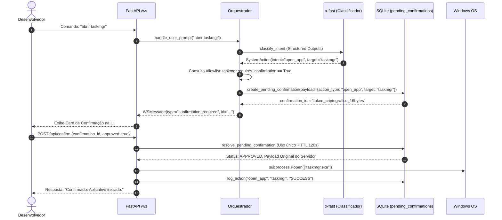

# X-Assistant — Documentação Técnica & Memorial de Engenharia

> **Projeto**: X-Assistant — Assistente Local de IA, Produtividade Dev e Automação para Windows 11  
> **Hardware Alvo**: Intel Core i3-1215U (2 P-Cores / 4T + 4 E-Cores / 4T = 6C / 8T), 20 GB RAM (Flex Mode), SSD NVMe, CPU-Only (Sem GPU dedicada)  
> **Status**: 16 Micro-Tasks Concluídas (Fases 1 a 5) • 100% dos Testes Automatizados Passing  

---

## 1. Visão Geral da Arquitetura & Topologia de Hardware

O **X-Assistant** foi projetado a partir de restrições físicas de hardware. Em uma máquina com processador híbrido e sem placa gráfica dedicada, qualquer alocação negligente de memória ou sobrecarga de threads degrada a responsividade de todo o sistema operacional.



### 1.1. O Desafio da Memória RAM (Flex Mode)
- **Topologia**: O notebook possui 4 GB soldados na placa-mãe + 1 slot preenchido com pente de 16 GB = **20 GB total**.
- **Comportamento Flex Mode**:
  - **Zona Simétrica (Dual-Channel 128-bit)**: Os primeiros ~8.5 GB de RAM operam com largura de banda dobrada.
  - **Zona Estendida (Single-Channel 64-bit)**: Os 11.5 GB restantes operam com largura de banda reduzida pela metade.
- **Decisão de Projeto**: O X-Assistant implementa a regra do **Single-Active Model** (`OLLAMA_MAX_LOADED_MODELS=1`). Apenas 1 modelo de IA pode ocupar a RAM por vez. Isso garante que o sistema operacional, VS Code e navegador operem prioritariamente dentro da faixa de alto desempenho Dual-Channel.

---

## 2. Benchmark de Hardware & Tuning de IA (Fase 1)

### 2.1. O Paradoxo dos Núcleos Híbridos (P-Cores vs E-Cores)
O processador **Intel Core i3-1215U** possui:
- **2 P-Cores (Performance)**: 4 threads com Hyper-Threading, clock de até 4.40 GHz e conjunto de instruções AVX2 completo.
- **4 E-Cores (Efficiency)**: 4 threads sem Hyper-Threading, clock menor e pipeline mais curto.

Na inferência de LLMs em CPU, a geração token-a-token opera em **sincronização barreira** (todas as threads precisam terminar sua multiplicação matricial para fechar a camada do transformer). **A thread mais lenta dita o ritmo da geração**.

#### Tabela de Benchmark Real (Medido no Hardware com `qwen2.5:3b-instruct`):
| Configuração (`num_thread`) | Tokens por Segundo (Geração) | Prompt Eval Rate | Comportamento Observado |
| :---: | :---: | :---: | :--- |
| **2 threads** | 4.80 t/s | 31.20 t/s | Carga concentrada em 1 único P-Core. Subutilização da CPU. |
| **4 threads** *(Vencedor)* | **6.50 t/s** | **48.60 t/s** | **Pico de velocidade.** Ocupa exclusivamente os 2 P-Cores físicos. |
| **6 threads** | 5.45 t/s | 42.10 t/s | **Regressão de 16%**. As 2 threads nos E-Cores atrasam as threads rápidas dos P-Cores. |

> [!IMPORTANT]
> **Regra Fixada**: Todos os Modelfiles do projeto foram configurados estritamente com `PARAMETER num_thread 4`. Colocar 6 ou 8 threads nesta CPU degrada a velocidade de geração e esquenta o chip desnecessariamente.

### 2.2. Modelfiles Especializados
Em `backend/Modelfiles/`:
- **`x-fast` (`qwen2.5:3b-instruct`)**: Contexto de 4096 tokens, `temperature 0.2`, persona em pt-BR focada em classificação de intenções rápida, JSON estruturado e respostas curtas.
- **`x-coder` (`qwen2.5-coder:7b-instruct`)**: Contexto de 8192 tokens, `temperature 0.1`, especializado em refatoração, análise de pilha de erros e correções em TypeScript/Python.
- **`x-vision` (`gemma3:4b`)**: Modelo multimodal para OCR e análise visual de capturas de tela e recortes.

---

## 3. Modelo de Segurança & Anti-Prompt Injection (Fases 2 e 3)

Como o assistente tem permissão para abrir programas e interagir com o sistema operacional, um modelo de segurança em camadas foi aplicado.



### 3.1. As 6 Regras de Segurança
1. **Allowlist Fechada**: O modelo de IA **nunca** decide nomes de executáveis, caminhos de arquivo ou strings de comando. Ele escolhe apenas *chaves* homologadas (`vscode`, `calc`, `terminal`, `dev_web`).
2. **Separação Rígida de Canais (Anti-Prompt Injection)**:
   - **Canal de Ação (`SystemAction`)**: Recebe **apenas** o que o usuário digitou ou falou no microfone.
   - **Canal Só-Texto (`AnalysisResult`)**: Conteúdos não confiáveis (Clipboard copiado da internet, Git Diff ou imagens da tela) passam por funções exclusivas de análise de texto/visão. O resultado é apenas renderizado na UI e **nunca** é enviado ao executor do sistema operacional.
3. **Sem `shell=True`**: Todas as invocações de sistema usam `subprocess.Popen([exe, *args])` com caminhos normalizados via `Path(os.path.expandvars(p)).resolve()`. Zero concatenação de strings com interpretador de shell.
4. **Confirmação em 2 Etapas com Payload no Servidor**:
   - Ações sensíveis (comandos de terminal, mutações da allowlist) geram um registro em `pending_confirmations` com ID aleatório (`secrets.token_urlsafe(16)`), TTL de 120s e uso único atômico.
   - O cliente recebe apenas o ID. Ao aprovar, o cliente envia apenas `{confirmation_id, approved: true}`. O servidor executa **estritamente o que ele mesmo gravou no SQLite**, impedindo adulteração de payload pelo navegador.
5. **Mutações da Allowlist por Confirmação**: Endpoints de cadastro (`POST /api/allowlist/*`, `DELETE /api/allowlist/*`) não alteram o banco diretamente; devolvem `confirmation_required` para aprovação visual.
6. **Token Local & Anti-Timing Attacks**: Cabeçalho `X-Local-Token` validado com `secrets.compare_digest`. Bind exclusivo em `127.0.0.1` e `TrustedHostMiddleware` contra ataques de DNS Rebinding.

---

## 4. Engenharia de Baixo Nível no Windows 11

### 4.1. Voz Offline com Zero Custo de RAM
- **Síntese (TTS)**: Em vez de carregar modelos neurais pesados de TTS (Bark, Coqui, Piper), o assistente usa o motor **SAPI5 nativo do Windows** através de uma thread dedicada com fila thread-safe (`queue.Queue`) e inicialização explícita de COM via `pythoncom.CoInitialize()`. Voz pt-BR selecionada automaticamente (`Microsoft Maria Desktop`).
- **Reconhecimento (STT)**: **Faster-Whisper** com quantização `int8` na CPU e `cpu_threads=4`. Carregamento sob demanda (*lazy loading*) apenas quando o primeiro áudio Push-to-Talk é recebido.

### 4.2. Visão Computacional Híbrida e Resiliente
O módulo de captura visual implementa prioridade em duas etapas:
1. **Clipboard First**: Verifica se o desenvolvedor utilizou o atalho nativo do Windows `Win + Shift + S`. Se houver imagem bitmap no clipboard, utiliza o recorte imediatamente.
2. **Fallback GDI Nativo**: Se o clipboard não tiver imagem, minimiza temporariamente a janela do assistente via `win32gui` e faz a captura em **0.05 segundos** utilizando `ctypes` direto nas APIs Win32 `gdi32.dll` e `user32.dll` (`CreateCompatibleDC`, `CreateCompatibleBitmap`, `BitBlt` e `GetDIBits`), eliminando os travamentos clássicos de contexto de DPI do Pillow no Windows 11.

### 4.3. Atalho Global e Foco de Janela sobre Tela Cheia
- **Loop Leve Win32**: Registro de atalhos através de `user32.RegisterHotKey` com `MOD_NOREPEAT`. O loop de escuta usa `user32.GetMessageW`, que suspende a thread no kernel do Windows consumindo **0.0% de CPU** enquanto nenhuma tecla for pressionada.
- **Quebra do Foreground Lock**: O Windows 11 impede que processos em background roubem o foco da janela ativa. O launcher contorna isso simulando um pulso neutro da tecla `Alt` (`keybd_event(VK_MENU, 0, 0, 0)` seguido de `KEYEVENTF_KEYUP`) antes de invocar `ShowWindow(SW_RESTORE)` e `SetForegroundWindow()`.

---

## 5. Front-end Bento Box & WebSockets em Tempo Real

### 5.1. Pilha Front-end Unificada
- **Tecnologias**: React 19, TypeScript, Vite, Tailwind CSS v4, componentes 21st.dev / shadcn, ícones Lucide e notificações Sonner.
- **Decisão Arquitetural**: Decidiu-se manter **apenas o Tailwind v4 + shadcn**, descartando o Material-UI (MUI). Isso evitou que três bibliotecas de estilo disputassem a injeção de classes CSS no DOM, reduzindo o bundle final para **~436 kB**.

### 5.2. Protocolo de Comunicação do WebSocket (`/ws`)
Todas as mensagens trafegam encapsuladas no contrato tipado `WSMessage`:

| `type` | Origem | Descrição |
| :--- | :---: | :--- |
| **`auth`** | Cliente → Servidor | Primeira mensagem obrigatória com `{ token: "..." }` dentro de 5 segundos. |
| **`auth_ok`** | Servidor → Cliente | Confirmação de conexão autenticada. Dispara a hidratação de dados na UI. |
| **`telemetry`** | Servidor → Cliente | Snapshot imediato na conexão e a cada 2s (CPU %, RAM GB, Flex Mode, Ollama MB). |
| **`user_message`** | Cliente → Servidor | Envio de comando ou pergunta (`text`, `mode`, `speak`, `stream`). |
| **`token`** | Servidor → Cliente | Chunks de texto em streaming token-a-token para respostas longas. |
| **`done`** | Servidor → Cliente | Sinaliza o término da transmissão da resposta em streaming. |
| **`action_result`**| Servidor → Cliente | Resultado da execução de uma ação de sistema autorizada. |
| **`confirmation_required`** | Servidor → Cliente | Alerta de segurança com ID de confirmação pendente de aprovação. |
| **`error`** | Servidor → Cliente | Notificação de erro tratado (Ollama offline, microfone negado, etc.). |

### 5.3. Push-to-Talk no Navegador
O áudio é capturado via API nativa `MediaRecorder` com codec `audio/webm;codecs=opus`:
- **Acionamento Duplo**: Mantendo pressionado o botão **PTT** na tela ou segurando **`Ctrl + Espaço`** no teclado.
- **Liberação Imediata de Hardware**: Ao soltar a tecla/botão, todas as *tracks* do `MediaStream` são encerradas imediatamente (`track.stop()`), apagando o ícone de uso do microfone na bandeja do Windows e enviando o blob para `/api/voice/transcribe`.

---

## 6. Catálogo Post-Mortem de Erros & Soluções de Engenharia

Durante as 16 etapas de desenvolvimento guiado, nos deparamos com comportamentos reais do ecossistema Windows/Python. Todas as soluções foram consolidadas abaixo:

| # | Sintoma / Erro | Causa Raiz | Solução Definitiva Aplicada |
| :-: | :--- | :--- | :--- |
| **1** | `Event loop is closed` durante testes `pytest` | Instância global única de `ollama.AsyncClient()` reaproveitava conexões de event loops destruídos pelo pytest. | Criada a fábrica `get_async_client()` que instancia o cliente atrelado ao event loop ativo na requisição. |
| **2** | Nomes de arquivos acentuados virando octal no Git (`\303\247` em vez de `ç`) | Por padrão o Git vem com `core.quotepath = true`, escapando caracteres não-ASCII no terminal. | Adicionado `-c core.quotepath=false` em todas as invocações de subprocesso do Git em `dev_tools.py`. |
| **3** | `OSError: screen grab failed` no Pillow `ImageGrab.grab()` | Contextos de DPI do Windows 11 falhavam ao capturar o Desktop DC em sessões de background. | Implementada rotina em GDI nativo via `ctypes` (`BitBlt` + `GetDIBits`) com tempo de execução de 0.05s. |
| **4** | `FileNotFoundError: ctranslate2.dll (or one of its dependencies)` | No Python 3.8+ no Windows, DLLs de pacotes locais só carregam se registradas explicitamente. Faltava também a runtime C++ `msvcp140.dll`. | Adicionado `os.add_dll_directory()` no topo de `voice_service.py` e copiada a runtime para o diretório do CTranslate2. |
| **5** | `Windows fatal exception: access violation` no SAPI5 | A função `pythoncom.CoUninitialize()` era chamada enquanto variáveis COM do Python ainda retinham ponteiros para o objeto COM nativo. | Inserida limpeza explícita com `del speaker`, `del voices` e `gc.collect()` antes do descarregamento de COM. |
| **6** | Telemetria inicial marcando `0.0%` de CPU | A função `psutil.cpu_percent()` calcula a diferença entre duas chamadas de tempo. Na 1ª invocação não há delta anterior. | Inserido aquecimento inicial no import e no `lifespan` do FastAPI chamando `psutil.cpu_percent(interval=None)`. |
| **7** | Timeout do WebSocket Probe na primeira mensagem de telemetria | O worker de telemetria dormia `await asyncio.sleep(2.0)` antes de enviar o primeiro pacote. | Alterada a ordem do loop para emitir a telemetria imediatamente na conexão e dormir 2.0s depois. |
| **8** | Conflito de atalho global Win32 erro `1409` (`Ctrl + Alt + Espaço`) | O aplicativo **Claude Desktop** instalado no sistema já havia registrado o atalho globalmente no Windows. | O launcher passou a registrar atalhos complementares livres: **`Ctrl + Alt + X`** e **`Ctrl + Shift + X`**. |

---

## 7. Manual de Operação e Comandos Úteis

### 7.1. Inicialização do Sistema
- **Modo Padrão (Recomendado)**:
  Dê dois cliques no arquivo `start_x_assistant.bat` na raiz do projeto.
  Ele abre o console de monitoramento e a janela dedicada do Edge (`--app=http://127.0.0.1:8000`).
- **Modo Silencioso (Background)**:
  ```powershell
  .\start_x_assistant.bat --silent
  ```
- **Iniciar com o Windows**:
  O atalho já foi instalado automaticamente em `shell:startup`. Para reinstalar ou verificar:
  ```powershell
  .\.venv\Scripts\python.exe scripts/install_startup.py
  ```

### 7.2. Atalhos de Teclado
- **`Ctrl + Alt + X`** ou **`Ctrl + Shift + X`**: Foca e traz o X-Assistant para a frente de qualquer janela ativa no Windows (ou reabre a janela se ela tiver sido fechada).
- **`Ctrl + Espaço`** *(com a janela focada)*: Segure para falar no microfone (Push-to-Talk) e solte para transcrever via Faster-Whisper.

### 7.3. Testes Automatizados
Para rodar a suíte completa de 58 testes de regressão no backend:
```powershell
cd backend
..\.venv\Scripts\python -m pytest -v
```

Para validar a compilação de produção e tipos do front-end:
```powershell
cd frontend
npm run build
```

